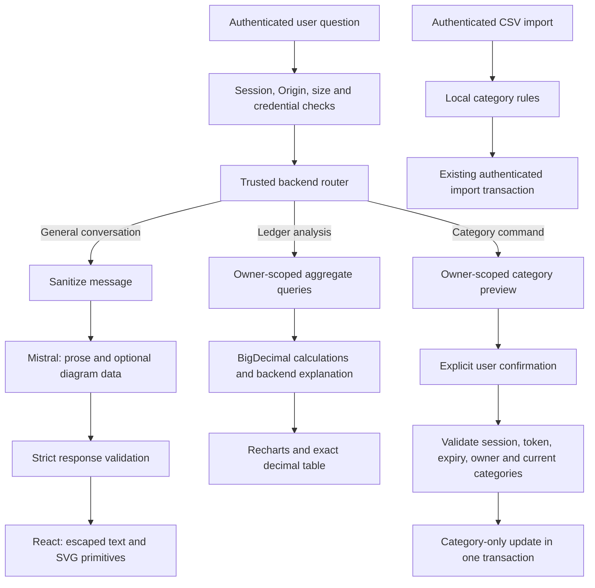

# PocketLedger assistant: implementation and security audit

## Current scope and authorization

The user clarified the original read-only Phase 2 requirement: general natural-language conversation, category changes, and automatic categorization of CSV imports are wanted. This implementation permits **only category edits** through a trusted backend preview/confirmation flow. It does not restore model-executable transaction creation, deletion, amount edits, arbitrary API calls, or SQL.

Work remains local on `Backend-Michaelsfinalimplementation`. No commit, push, merge, deployment, migration, or shared database change was performed. Existing Phase 1 work was preserved.

## Architecture



Mistral has no database connection, repository reference, session object, server/file capability, tool/function definition, or operation dispatcher. Its returned text and diagram data are display-only. It cannot query the database, select an owner, or execute edits. Application code performs approved queries and updates on behalf of the authenticated user.

Recognized financial requests and category operations do not require Mistral. Other natural financial questions now use a screened interpretation fallback: Mistral may return only an approved read-analysis selection; Spring Boot validates it and supplies the owner from the authenticated session. The model’s acknowledgement and any invented amounts are discarded, and the backend generates the actual answer. Unsupported explicit date ranges still receive local clarification. The old `AiOrchestratorService`, `AiPendingActionStore`, `AiActionClassification`, and `AiActionParameters` remain removed.

## General conversation and privacy

General questions are sent to Mistral after local screening. This deliberately replaces the earlier finite-selection-only chat restriction, consistent with the user's request for natural conversation. Financial calculation results and records are never appended to those prompts.

`ChatSanitizer` blocks detected credential-bearing requests, including labeled passwords/API keys/tokens, bearer tokens, JWTs, connection strings, private-key blocks, SSN/card-like sequences, and long token-like strings. A blocked request is not sent to Mistral and its raw text is not echoed by the application response. Emails, URLs, labeled identifiers, phone-like values, explicit name introductions, currency amounts, and numbers in recognized personal-finance statements are redacted from general prompts.

**Important limit:** heuristic screening cannot identify every arbitrary password, personal name, account number, or secret hidden in otherwise ordinary text. The implementation must not be described as a guarantee that every possible secret is detected. The UI tells users never to enter passwords or API keys. The actual password field, stored password hashes, credential configuration, session cookies, database credentials, uploaded CSV, and repository results are never supplied to the conversation adapter.

The provider key is read only from backend `MISTRAL_API_KEY` and used in the provider Authorization header, never the prompt or frontend. The endpoint and model are fixed in application code; redirects are disabled. Prompts contain fixed public-facing assistant instructions and the screened current question, without backend configuration or application source. No raw prompt, provider body, or model output is logged.

General conversation is single-turn. Financial follow-ups retain only the most recent finite intent, relative period or selected calendar month, category, and chart in the authenticated session. Previous private answers, records, and full conversation transcripts are not sent back to Mistral.

## Untrusted model output and visualizations

The only accepted conversation response is exactly:

```json
{
  "reply": "Natural-language response",
  "diagram": null
}
```

Only `reply` is required; `diagram` may be omitted or null. An optional diagram can replace null with `{ "nodes": ["label"], "edges": [{"from": 0, "to": 1}] }`. The parser bounds replies, label lengths, diagram size (12 nodes, 24 edges), and edge indexes. It rejects extra fields, duplicate JSON keys, trailing JSON, malformed data, missing content, function/tool-call responses, and provider bodies over 32 KiB. An optional `analysis` property is accepted only with exactly the fields `intent`, `period`, `category`, `chart`, and `month`. Intents, categories, periods and charts are closed enums; a selected month must be a valid YYYY-MM in 1900–2099. The month must be null for relative periods. A null chart uses a safe backend default; it has no effect on query scope. Budget status must use all categories and a bar chart. Unknown fields, owner IDs, SQL, write intents, arbitrary dates, invalid months, duplicate keys and trailing content are rejected before any financial query.

No model-supplied SQL, HTML, SVG markup, URL, script, action, or method is executed. An analysis selection is data consumed by approved application code, never an arbitrary backend API/tool call.

React renders replies as text. Diagrams use application-owned SVG elements with escaped labels; the application never inserts model markup with `innerHTML`. A reply claiming that records were changed has no effect on any backend operation.

Recharts renders ledger donut/bar/line charts from trusted backend calculations. Monetary values are computed with `BigDecimal` and returned as decimal strings; float conversion is only for plotting, with exact backend strings retained in the table/tooltip. Negative series use line/bar charts rather than an invalid donut. Additional educational plots support fixed backend formulas `x²`, `sin(x)`, and `cos(x)`; no arbitrary expression or model code is evaluated.

Simple diagrams are implemented. Photorealistic image generation, arbitrary raster images, and an image-generation provider are not connected. Numerical chart data is never fabricated from model output.

Free Untitled UI chart helpers were adapted from MIT-licensed upstream commit `1d410cb8facde8d50869e7bbb5f3d048e2267466`. The license is retained at `frontend/licenses/untitled-ui-MIT.txt`. Recharts loads lazily; existing app styling is preserved through scoped CSS.

## Authentication and financial analysis

The existing `SessionGuard` checks trusted Origin, account verification, session version, and lifetime. Unsafe API calls require the configured Origin. Responses use `Cache-Control: no-store`. The assistant accepts only a current session owner and a single query field of at most 1,000 characters. It rejects extra owner/operation parameters. Requests are rate-limited per owner on this backend instance.

The four local analyses are spending by category, monthly expenses, budget status, and income trend. Supported periods are this/last month, this/last year, the last 6/12 months, and named calendar months such as October or February 2024. A named month without a year resolves to the most recent occurrence; an explicit year is retained. Selected calendar months cover the full month, and explanations display the exact start/end dates. Unsupported or ambiguous personal-finance periods request clarification locally instead of falling through to Mistral. All repository queries bind the authenticated owner; the model never supplies an ID, query, amount, or date filter. The aggregate query returns month/category totals, without loading raw transaction names, descriptions, or history into the analysis service.

Income and expenses remain separate under the existing signed ledger convention; positive refunds count as income. Missing months are zero-filled; missing budgets are explicitly reported. Unknown stored categories are normalized to Other for chart labels. The backend constructs financial explanations in conversational prose and never sends them to Mistral. Natural interpretations produce only a validated selection; backend queries and calculations remain authoritative. The current ledger has no per-transaction currency metadata; explanations identify amounts as ledger currency.

## Category editing

Supported commands include:

- `categorize "coffee" as Groceries`
- `categorize #42 as Transport`
- `autocategorize my transactions`

These are parsed by reviewed application code. Model replies never initiate commands or HTTP requests. Keyword matching is a literal transaction-name substring, not SQL or a user-supplied query. IDs use an owner-scoped repository lookup. Category choices are restricted to the seven existing ledger categories.

A preview contains only matching owned transactions, prior categories, proposed categories, and a random confirmation token. The draft is retained in the authenticated session for five minutes, with at most 100 changes. There is no write when generating a preview.

Confirmation requires an explicit button click or a direct user `yes`/`confirm` message while a preview exists. The backend rechecks owner, token, expiry, and each current category. It locks only the owner's requested rows before validation. All draft entries must remain valid before changes are applied transactionally. A changed/deleted/foreign transaction causes rejection; no partial category edit is made. Only the category field is updated: amount, date, name, notes, and ownership stay unchanged.

The confirmation token is single-use. Clear context, cancel, unrelated questions, logout, or session expiry invalidate the pending preview. A failed/stale confirmation requires a new preview. Model-generated text saying “yes” or claiming completion is not interpreted as user confirmation.

## Automatic CSV categorization

CSV parsing/import remain local in Spring Boot. The existing authenticated import assigns every row to the current session owner; user IDs are not taken from the file.

Missing/blank categories receive conservative local keyword/merchant rules based on name and optional description. Supported categories are Clothing, Entertainment, Transport, Groceries, Salary, Rent, and Other. Multiple/conflicting matches and unknown merchants remain Other. Salary suggestions require a positive amount.

Optional `category` or `type` columns preserve explicitly supplied valid categories, including Other, with case normalization. Unsupported categories reject the import before any save. Existing three-column files remain supported. The CSV contents, merchant labels, descriptions, dates, amounts, and saved transactions are **never sent to Mistral**. Existing classified records are not silently overwritten by the automatic command.

## Natural-language interpretation and response compatibility

The assistant now handles natural paraphrases through a screened model interpretation fallback, rather than requiring each possible sentence to be added to a keyword list. Existing high-confidence local analysis paths remain available without a provider call. Follow-ups such as “And how much room did I have left then?” can use only the previous approved financial selection.

Two synthetic provider checks used the app’s current instructions and `ministral-8b-latest`, with no database record, credential, or private calculation in the prompt. “What did I shell out on food during the month before this one?” returned HTTP 200 and selected `spending_by_category`, `LAST_MONTH`, `Groceries`. The model omitted the optional diagram and returned a null chart. This observed response is covered by a regression test and is now accepted with a safe default presentation, rather than reported as unavailable.

Optional presentation fields no longer prevent valid natural replies. Invalid interpretations still fail closed and receive an interpretation-specific error in the UI, distinct from account limits or outages. Tests prove that model-invented amounts are not displayed, model selections cannot supply an owner or operation, approved selections use the authenticated owner, and only finite context accompanies follow-ups. The live check validates provider compatibility and one paraphrase, not universal understanding or private-data/database integration.

## Named-month budget routing fix

The exact question “can you show me my october budget” was reproduced in an isolated JVM test. IntelliJ debugger inspection at `NamedMonthAnalysisTest` confirmed `prepared.supported() = false`: the old parser rejected named months and the controller fell through to external conversation.

The parser now supports named months and explicit years. The exact request and “explain my October budget” route to owner-scoped local analysis without calling Mistral. Tests cover full October dates, leap February, year rollover, finite follow-up context, owner-scoped monthly budget lookups, and local clarification for ambiguous periods. No live financial records or user questions were sent to Mistral for this diagnosis, and no shared database data was modified.

## Availability diagnosis and model compatibility fix

A direct comparison using the same configured key and entirely synthetic prompts identified a model-specific allowance difference:

- Main's `ministral-8b-latest`: HTTP 200 with a valid JSON reply, 2 requests/minute and 40,000 tokens/minute.
- The initially substituted `mistral-small-latest`: HTTP 429, code 1300, with an allowed request rate of 0/minute.

The earlier account-wide interpretation of the zero rate was too broad. The key works with main's model; replacing the key is not the required application fix. The adapter now uses `ministral-8b-latest`, matching main, and the captured-request regression test asserts that model. No billing settings were changed.

These diagnostics sent no user message, database record, financial result, or recipient. They establish provider access and basic structured-output compatibility, not complete live conversation or browser validation. Actual rate limits remain subject to Mistral's model/account settings; this observed 2-request/minute allowance can still be exhausted by rapid requests or shared usage.

The adapter and UI distinguish missing key, provider authorization rejection, provider 429, and other outages without exposing raw provider bodies. General conversation depends on the provider, while local financial charts, CSV categorization, and category confirmation do not.

## Validation

- Backend Maven tests: **80 passed**, zero failures/errors, including regression tests for the existing account and transaction functionality.
- Frontend Vitest tests: **12 passed**.
- Frontend production build and lint: passed.
- Git whitespace checks: passed.

Backend tests cover real aggregate queries and row locks on disposable H2 with separate users; exact decimal sums; owner/date scoping; budgets and zero-fill; credential blocking/redaction; actual captured mocked HTTP payloads; malformed/tool/operation model output; provider 429/auth/key errors; absence of legacy executable action classes; category preview without writes; category-only confirmation; stale/wrong-owner/token/expiry rejection; literal keyword matching; CSV defaults and explicit categories; and invalidation/replay rejection for confirmation.

Frontend tests cover request payloads without previous private answers, provider-error messages, local chart switching, exact decimal table values, empty states, preview-before-confirmation, token-only confirmation requests, context clearing, and escaped diagram labels.

No shared Supabase writes, migrations, or live model conversation were used for testing. Synthetic provider checks confirmed HTTP 200 with main’s model and HTTP 429 with the previously substituted model. Database tests use H2, not shared PostgreSQL. Full browser visual testing, real Mistral responses, and real PostgreSQL integration of these new operations remain unverified.

## Remaining risks and limits

- Screening is best-effort, not perfect secret/PII detection. Users must not type credentials into chat.
- General replies and diagrams are untrusted model-generated content and can be factually wrong; they are not private ledger facts or proof of backend operations.
- Category rules are conservative; ambiguous merchants remain Other. Broader language for edits receives command guidance rather than arbitrary model-executable actions.
- Authenticated category-preview queries currently inspect the owner's existing transactions in the backend; larger datasets will benefit from paginated matching.
- Session drafts and per-owner rate counters are in memory on one backend instance; scaling requires shared state/limits.
- This is an application capability boundary, not an OS/network sandbox for a compromised backend host.
- `npm audit` reports two existing high-severity findings involving Vite and `source-map-js`; both packages were in the original lockfile. Unrelated dependencies were not silently upgraded. Those findings remain an outstanding dependency-security task before deployment.

## References

- [Mistral chat API and JSON output](https://docs.mistral.ai/api)
- [Mistral usage and limits](https://docs.mistral.ai/admin/billing-usage/usage-limits)
- [Mistral HTTP 429 guidance](https://help.mistral.ai/en/articles/698531-why-am-i-hitting-api-rate-limits-and-how-do-i-increase-them)
- [Recharts sizing](https://recharts.github.io/en-US/guide/sizes/)
- [Pinned free Untitled UI chart source](https://github.com/untitleduico/react/blob/1d410cb8facde8d50869e7bbb5f3d048e2267466/components/application/charts/charts-base.tsx)
